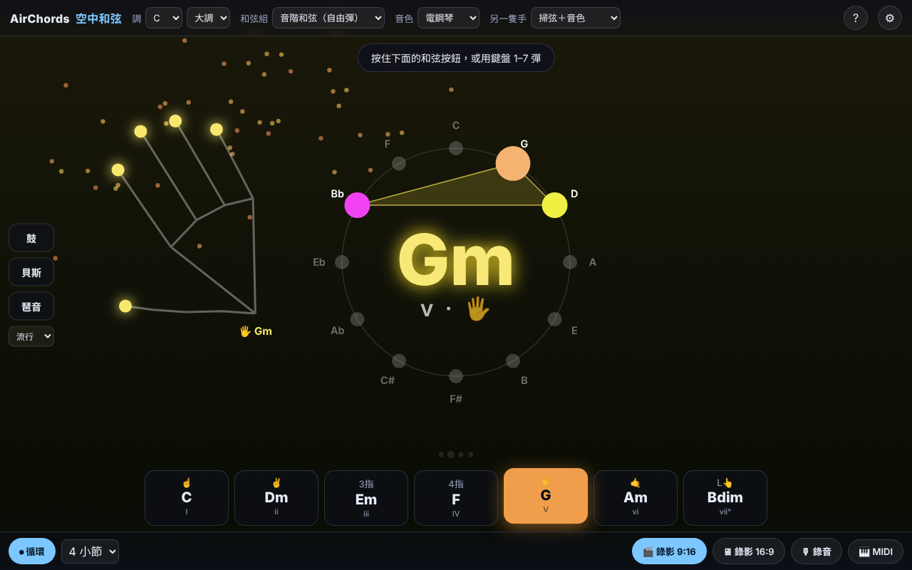

# AirChords 空中和弦 🤚🎹

對著鏡頭比手勢就能彈和弦的網頁樂器。一隻手決定和弦，另一隻手掃弦、調音色或彈旋律；不開鏡頭也能用觸控或鍵盤彈。

**Live demo:** https://baize404.github.io/air-chords/



A browser instrument you play by showing chords to your webcam: one hand picks the chord, the other strums, shapes the tone or plays a melody. Works with touch or a keyboard too. Everything runs on your device.

## 集百家之長 / What it takes from other gesture synths

網路上已經有十幾個「gesture synth」網站。這個版本把各家做得好的地方合在一起，再把常見的問題拿掉：

| 從哪裡學來 | 做法 | 這裡怎麼做 |
| --- | --- | --- |
| Indecisive Eric 的 gesture synth | 用手指數量選和弦 | 和弦手比 1–5 根手指，加上 🤙、L 形，共 7 個和弦 |
| gesture.live | 和弦只用一隻手，另一隻手空出來玩別的 | 另一隻手可以掃弦、調亮暗和音域、彈旋律或滑音 |
| gesture-synth.com 的 Mouse Mode | 不開鏡頭也能玩 | 觸控和弦按鈕、拖曳區、完整鍵盤操作 |
| 幾個版本的「Theremin 模式」 | 連續音高 | 「滑音」模式 |
| 有 loop pedal 和 MIDI 的版本 | 循環錄音、匯出 MIDI | 循環錄音可疊錄；MIDI 免費匯出，分軌（和弦、旋律、貝斯、琶音、鼓） |
| 有標示本機處理的版本 | 畫面不上傳 | 手部追蹤模型和程式都放在網站裡，鏡頭畫面不離開裝置 |
| 一般網頁樂器 | 選調性 | 12 個調、大調／小調，加上六組流行和弦進行，比 1–4 根手指就能彈整首歌 |

拿掉的問題：

- **要登入、要付費才能下載影片** → 不用帳號，錄多久都能免費下載
- **只能錄 15 秒** → 沒有長度限制；還有直式 9:16，可以直接發 Reels／Shorts
- **打開沒聲音**（瀏覽器規定要先按一下才能出聲）→ 開始畫面就是那一下
- **要先學一堆手勢** → 下方按鈕永遠顯示「幾根手指＝哪個和弦」，手旁邊即時顯示認到什麼
- **手指晃一下就換和弦** → 手勢要穩定幾個畫面才算數
- **鎖在節拍格上，失去人味** → 換和弦要不要對齊拍子可以自己選，預設照手的時間
- **依賴外部 CDN、被擋廣告的外掛擋掉** → 追蹤模型和程式都放在同一個網站

## 怎麼彈 / How to play

**和弦手（預設在畫面左半邊，可在設定裡改成右邊）**

| 手勢 | 和弦（C 大調、音階和弦） |
| --- | --- |
| ☝️ 1 根手指 | I　C |
| ✌️ 2 根手指 | ii　Dm |
| 3 根手指 | iii　Em |
| 4 根手指 | IV　F |
| 🖐 整隻手張開 | V　G |
| 🤙 拇指＋小指 | vi　Am |
| L 形（拇指＋食指） | vii°　Bdim |
| ✊ 握拳 | 停 |

- 手往畫面中間傾斜：加七和弦（例如 G → G7）
- 手往外傾斜：大小調互換，彈出借用和弦（例如 F → Fm）
- 「和弦組」選流行四和弦、王道進行、卡農、50 年代、爵士 ii–V–I 時，1 根手指就是那組的第一個和弦，依此類推

**另一隻手**

- **掃弦＋音色：** 往下一揮＝掃弦；手越高聲音越亮；左右位置換低、中、高音域；握拳＝止音
- **彈旋律：** 食指的高度決定音高（預設五聲音階，怎麼彈都和諧），拇指和食指捏起來才發聲
- **滑音：** 像特雷門琴一樣連續變化音高

**觸控／鍵盤**

- 按住下方的和弦按鈕；在畫面另一半拖曳＝調音色或彈旋律，輕點＝掃弦
- 鍵盤 `1`–`7` 和弦、`Shift` 七和弦、`M` 大小調互換、空白鍵掃弦、`↑` `↓` 亮暗、`Z` `X` 音域、`Q`–`P` 旋律、`L` 循環錄音

**其他**

- 四種音色：電鋼琴、溫暖合成、撥弦吉他、管風琴
- 鼓、貝斯、琶音（流行、Lo-fi、Bossa 三種節奏），貝斯和琶音會跟著你的和弦走
- 循環錄音 2／4／8 小節，播放中再按一下就疊錄
- 錄影 9:16、16:9，或只錄音；🎹 匯出 MIDI 可以拖進 GarageBand、Logic、FL Studio

## 隱私 / Privacy

手部追蹤用 Google MediaPipe Hand Landmarker，在瀏覽器裡執行。鏡頭畫面只在你的裝置上分析，不會上傳；錄好的影片、錄音和 MIDI 也只存在你的裝置上。

## 開發 / Development

不需要建置步驟，純 HTML + JavaScript 模組。

```bash
python3 -m http.server 8000      # 打開 http://localhost:8000
node tests/test.js               # 樂理和手勢判讀的測試
```

- `js/theory.js`：調性、和弦、和弦進行、旋律音階
- `js/hands.js`：載入 MediaPipe、從 21 個關節點判斷手勢（手指數、傾斜、捏合、揮動）
- `js/audio.js`：Web Audio 音色、鼓、貝斯、琶音、殘響、回音和節拍時鐘
- `js/looper.js`：循環錄音
- `js/recorder.js`：錄影、錄音、MIDI 匯出
- `js/visuals.js`：畫面（手的骨架、五度圈和弦環、旋律梯、粒子）
- `vendor/mediapipe/`：MediaPipe 程式和手部模型（Apache-2.0），見該資料夾的 README

建議用電腦版 Chrome 或 Edge。手機也能開；手機鏡頭追蹤比較吃效能，跑不動時可以改用觸控。

## Credits

靈感來自 [Indecisive Eric 的 gesture synth](https://indecisiveeric.com/gesture-synth) 和 [gesture.live](https://gesture.live/)；這是獨立實作，沒有使用它們的程式碼。手部追蹤：[MediaPipe](https://ai.google.dev/edge/mediapipe)（Apache-2.0）。
